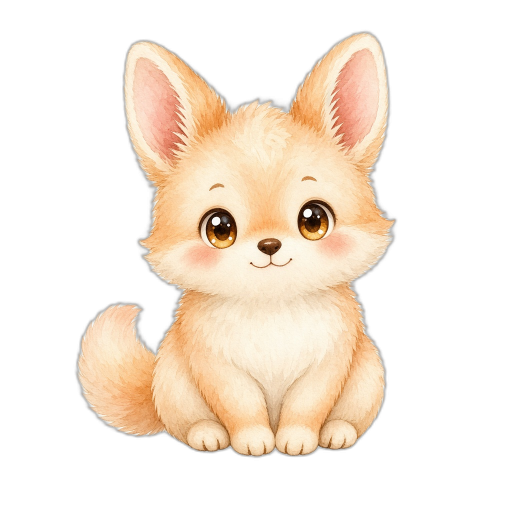

# PetOS · 我的宠物

<p align="center">
  
</p>

<p align="center"><strong>PetOS</strong> · 我的宠物</p>

## Logo

官方品牌图标来自仓库根目录的 [`icons.zip`](icons.zip)，已解压到 [`assets/brand/`](assets/brand/)：

| 文件 | 用途 |
|------|------|
| `assets/brand/logo.png` | README / 文档主图（512×512） |
| `assets/brand/webapp/android-chrome-512x512.png` | 高清应用图标 |
| `assets/brand/webapp/android-chrome-192x192.png` | 中等图标 |
| `assets/brand/webapp/apple-touch-icon-180x180.png` | Apple Touch |
| `assets/brand/webapp/favicon-32x32.png` / `favicon-16x16.png` | Favicon |
| `assets/brand/webapp/favicon.ico` | ICO 多尺寸 |
| `assets/brand/webapp/site.webmanifest` | Web App Manifest |

Electron / 安装包图标请优先用 `assets/brand/logo.png` 或 512 图；改品牌时替换 `icons.zip` 后重新解压到 `assets/brand/`。

---

通用桌宠框架：**玩法内置，皮囊自绘**。产品不绑定任何具体宠物形象；外观、动画、文案全部由用户素材包驱动。

## 技术栈（已锁定）

| 层 | 选型 |
|---|---|
| 壳 | Electron |
| UI | Vite + TypeScript + React |
| 立绘 | PNG/WebP **帧序列**、动画 WebP、静图；**Spine** 为高质量骨骼动效路径；缺动画用 CSS 缓动 |
| 素材包 | 文件夹或 ZIP + 声明式 `manifest.json`（schema 1） |
| 持久化 | electron-store（userData） |

**不做**：SWF / Ruffle / 任何 Flash 运行时。

## 快速开始

```bash
cd /Users/ankio/Documents/SourceCode/HTML/petos
npm install
npm run dev
```

开发模式下会同时启动 Vite 与 Electron 窗口。

```bash
npm run build    # 类型检查 + 构建
npm run typecheck
```

## 使用说明（M1）

1. 首次启动会自动激活内置示例包 **小糯**（`packs/demo-mochi`），可直接 **摸 / 喂 / 睡**（「玩」为占位）。卸下素材包后回退几何占位宠。
2. 四维需求：饱腹、心情、精力、整洁；空闲会缓慢下降。危急时只软提示 / 想睡，**不会死亡**。
3. 导入素材包：拖入 ZIP、选择 ZIP、选择文件夹，或点「导入空白模板」。
4. 当前激活包名显示在面板上；可「卸下」回到占位宠。


## 示例素材

仓库自带官方示例包 [`packs/demo-mochi`](packs/demo-mochi)（角色名：**小糯**）：

- 奶油桃色圆团子，512×512 透明 PNG 帧序列
- 姿态：`idle`（呼吸+眨眼）/ `pet` / `eat` / `sleep`
- 首次无激活包时应用会自动导入并启用
- 也可在界面中「选择文件夹」指向该目录，或按同样结构自制素材包

创作说明见包内 [`packs/demo-mochi/README.md`](packs/demo-mochi/README.md)。

## 素材包约定（schema 1）

根目录必须有 `manifest.json`：

```json
{
  "schema": 1,
  "meta": { "name": "我的小猫", "author": "you" },
  "poses": {
    "idle": { "src": "idle.png" },
    "pet": { "src": "pet.webp", "ms": 900 },
    "eat": { "src": "eat.png" },
    "sleep": { "src": "sleep.png" }
  },
  "voice": {
    "pet": ["呼噜……", "再摸摸"],
    "hungry": ["……肚子叫了"]
  }
}
```

- **必需**：`meta.name`、`poses.idle`
- **可选**：`pet` / `eat` / `sleep` / `sad` / `hunger`、`voice`、`items`
- 缺姿态 → 回退 idle + 弹跳/变暗/着色；坏图跳过，应用保持可用
- 姿态类型：`frames`（帧序列，M1 主力）/ `image`·`webp`（单图或动画 WebP）/ `spine`（骨骼，见 docs/spine-pack.md）
- 图片格式：**PNG、WebP**；禁止 SWF / Flash / Ruffle
- 安全：仅资源 + 声明式 JSON，**永不 eval 包内脚本**

空白模板见 `templates/blank-pack/`（含中文创作者说明）。

## 目录结构

```
petos/
  icons.zip          # 品牌图标源包
  assets/brand/      # 解压后的 logo / favicon
  packs/demo-mochi/  # 官方示例素材（小糯 · 帧序列）
  electron/          # main + preload
  src/
    engine/          # 需求衰减与交互
    pack/            # schema / 加载 / 回退
    ui/              # 占位宠、导入、控制条
    render/          # 帧序列 / WebP / Spine 姿态渲染
  templates/blank-pack/
  docs/design.md
```

## 设计文档

详见 [docs/design.md](docs/design.md)（含成长/学习/出行/事业/性格等后期系统文档占位，M1 未实现）。
